<div align="center">


# FinSight

**Bank statements in. Explainable credit figures out.**

Reads PDF, CSV, Excel and JSON statements, reconciles every row, gives each transaction a visible reason,<br>
and links every figure back to the file, page and row behind it.

      

[Screens](#screens) · [How it works](#how-it-works) · [Hard cases](#hard-cases) · [Run it](#run-it) · [Docs](#documentation) · [Limits](#known-limits)

</div>

<br>

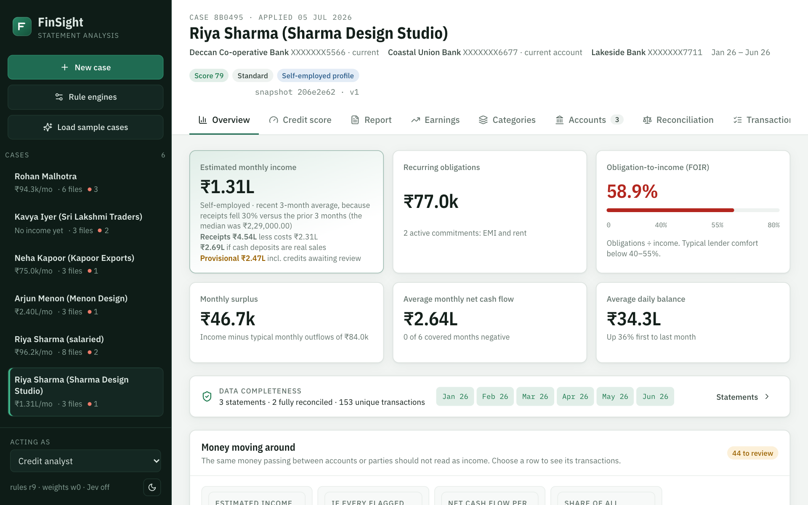

<p align="center"><sub>All screens use fictional sample customers. Names, accounts and amounts are made up.</sub></p>


<table>
<tr>
<td width="25%" valign="top">

### 🧮 Rules decide
Rules and arithmetic set every category and figure. The same files and versions give the same result.

</td>
<td width="25%" valign="top">

### 🔍 Everything traces
Every figure lists the rows it included and excluded, with reasons, down to file, page and row.

</td>
<td width="25%" valign="top">

### 📭 Nothing invented
A missing month is unknown, never zero. An unreadable page is reported. An uncertain row waits for a person.

</td>
<td width="25%" valign="top">

### ✍️ Analysts decide
Correct or exclude any row and every figure recalculates. The original is kept and the change is audited.

</td>
</tr>
</table>

## Screens

> [!NOTE]
> These screenshots come from the latest development copy, which is ahead of this repository: it adds a sample package and regional-language rules, among other changes. The documents in `docs/` describe that copy too.

<table>
<tr>
<td width="50%" valign="top">

**Why a row got its category**<br>
<sub>Each signal's weight, the resulting probability, the recurring series, and the source file, page and row.</sub>

<a href="docs/images/why.png">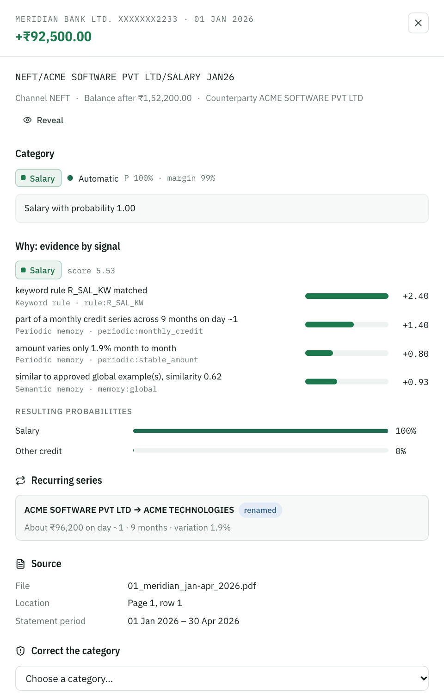</a>

</td>
<td width="50%" valign="top">

**What is behind a figure**<br>
<sub>Click any figure for its method, notes, supporting statistics and the rows counted and left out.</sub>

<a href="docs/images/figure.png">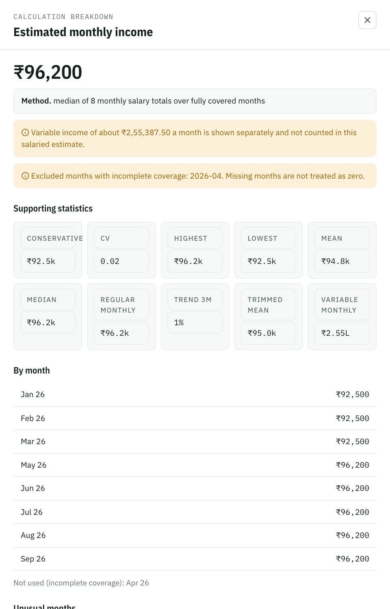</a>

</td>
</tr>
<tr>
<td width="50%" valign="top">

**Money moving around**<br>
<sub>Circles, round trips and pass-through are held for review. Here income reads ₹1.31L, not the ₹9.83L it would if every flagged credit were real.</sub>

<a href="docs/images/rotation.png">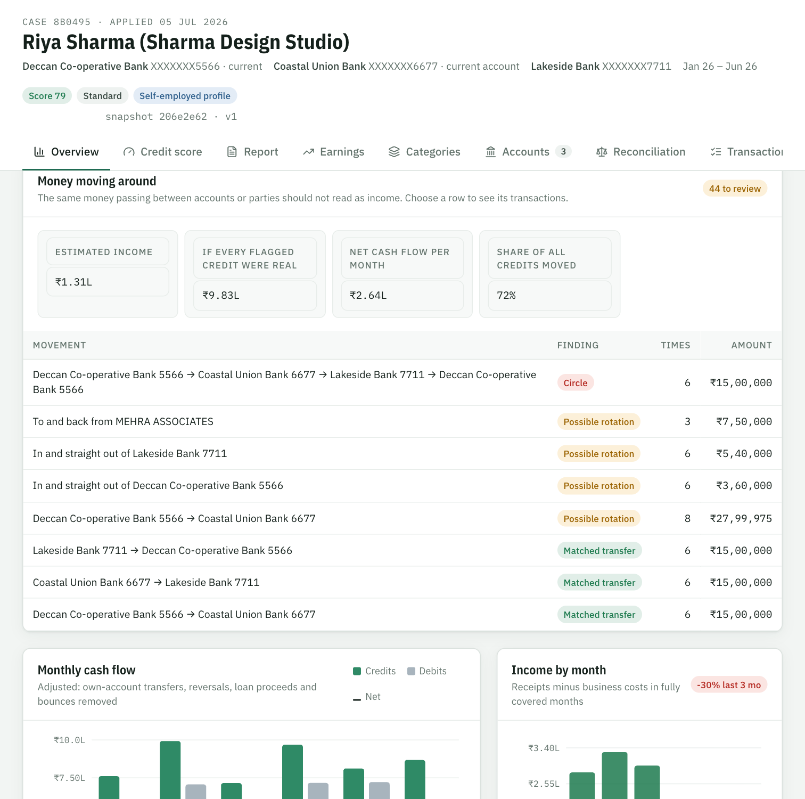</a>

</td>
<td width="50%" valign="top">

**Missing months stay missing**<br>
<sub>Coverage per account and month. April has no Northwind statement, so it is reported, not counted as zero.</sub>

<a href="docs/images/coverage.png">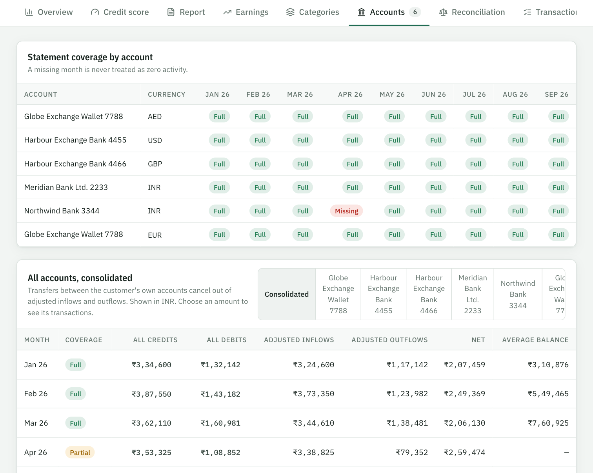</a>

</td>
</tr>
<tr>
<td width="50%" valign="top">

**A credit score that shows its work**<br>
<sub>Every parameter's measured value, limits, points and supporting rows. Not a bureau score and not a decision.</sub>

<a href="docs/images/score.png">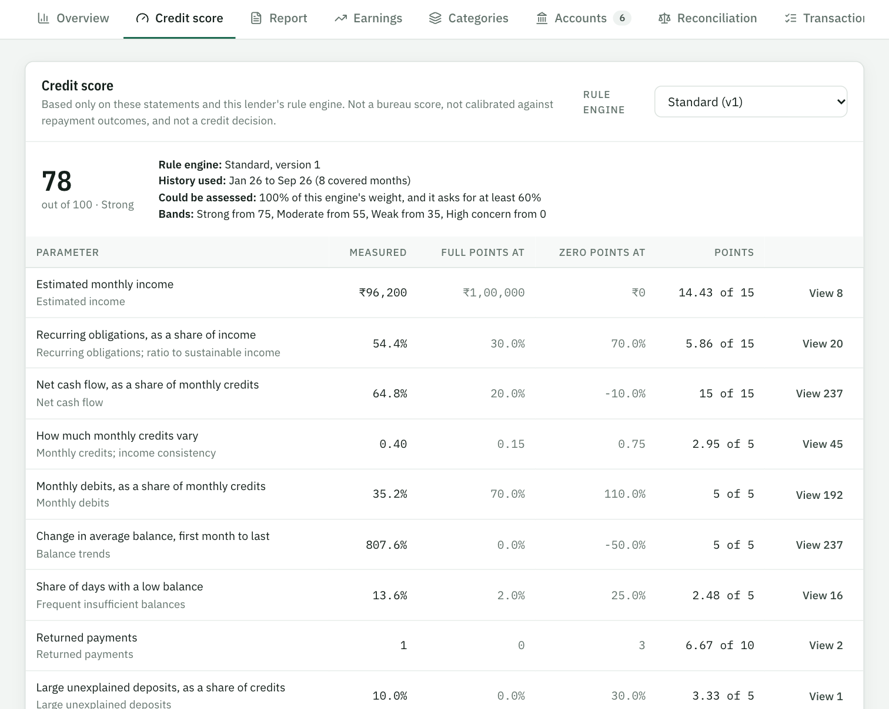</a>

</td>
<td width="50%" valign="top">

**Reconciliation against the lender's rules**<br>
<sub>Opening + credits − debits = closing, with breaks, gaps, overlaps and matched own-account pairs.</sub>

<a href="docs/images/reconciliation.png">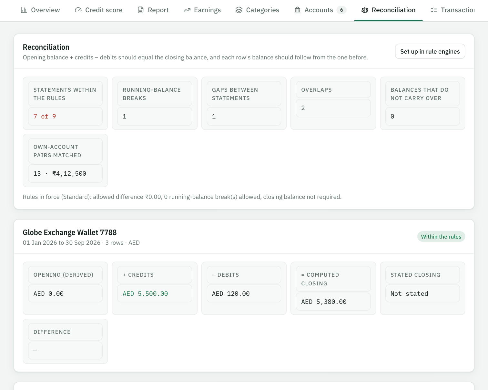</a>

</td>
</tr>
<tr>
<td width="50%" valign="top">

**Risk indicators, for review**<br>
<sub>Each states its rule and its rows. None is a finding of fraud.</sub>

<a href="docs/images/indicators.png">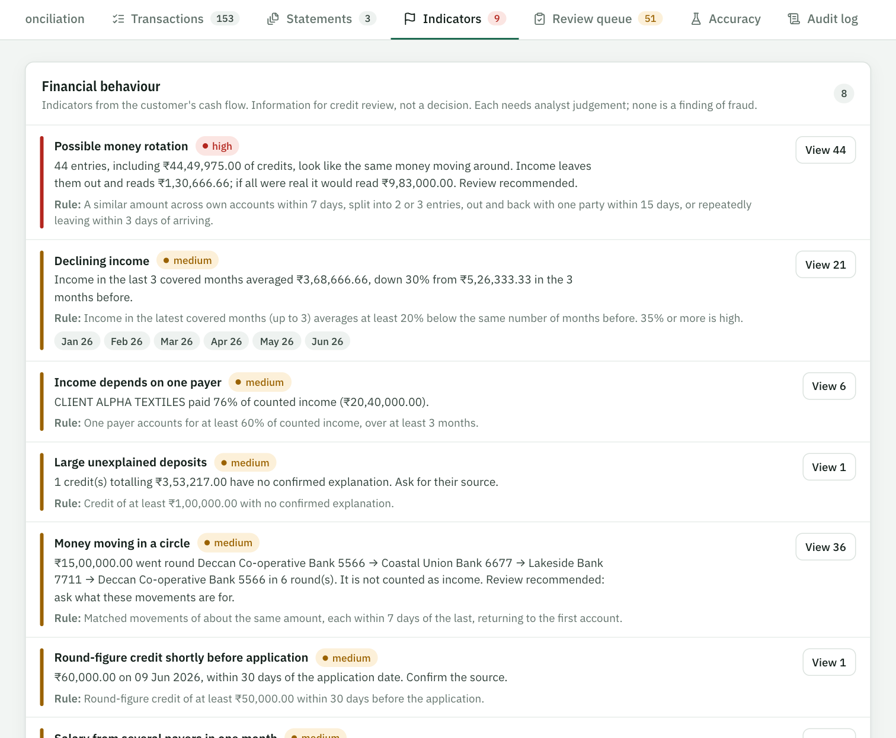</a>

</td>
<td width="50%" valign="top">

**Each lender's own rule engine**<br>
<sub>Copy Standard, change the settings, and every save becomes a new version with who changed it.</sub>

<a href="docs/images/engines.png">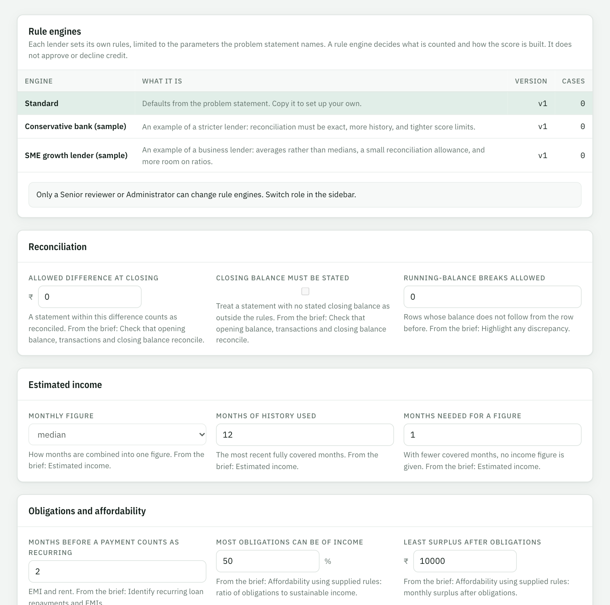</a>

</td>
</tr>
<tr>
<td width="50%" valign="top">

**A queue for what is uncertain**<br>
<sub>Weak or conflicting evidence waits here, and income leaves it out until someone decides.</sub>

<a href="docs/images/review.png">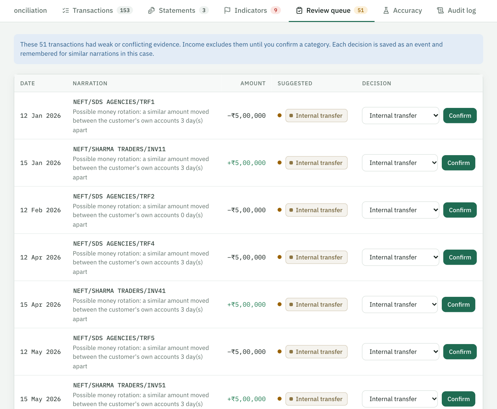</a>

</td>
<td width="50%" valign="top">

**An evidence-linked report**<br>
<sub>The assessment as one document, with indicators, breakdowns and links back to source rows.</sub>

<a href="docs/images/report.png">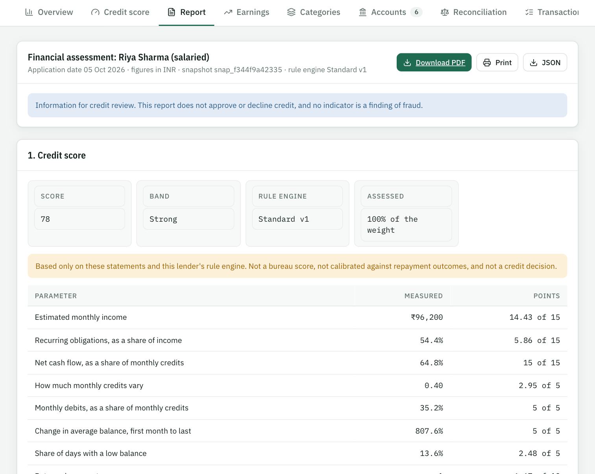</a>

</td>
</tr>
</table>

## How it works

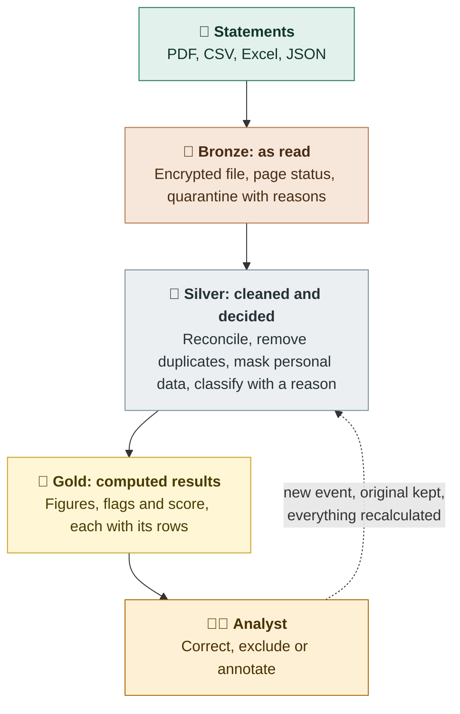

### Every transaction passes three tiers

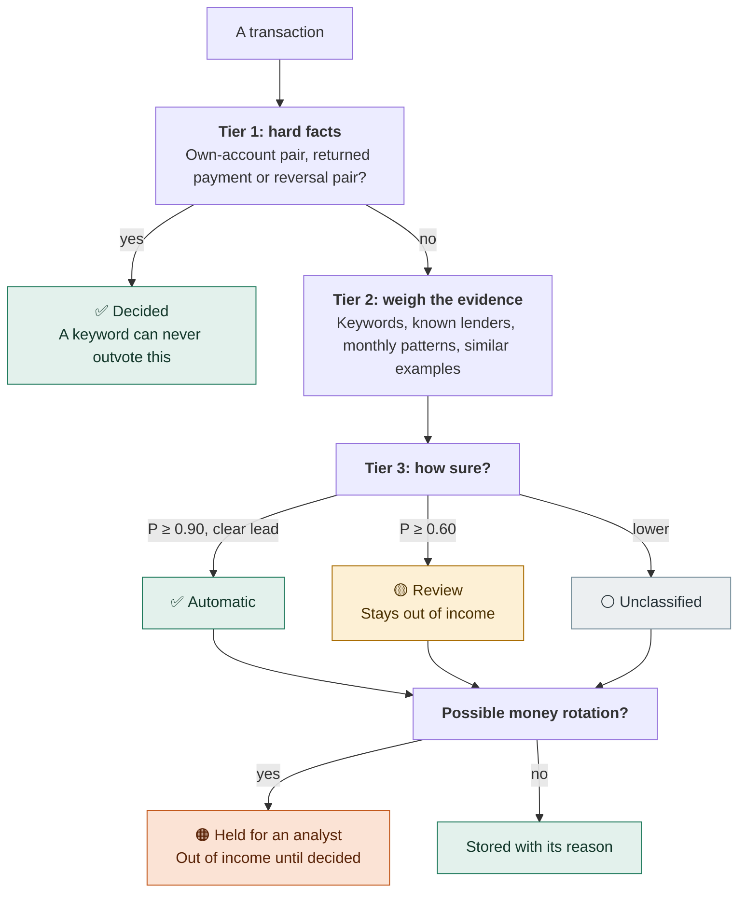

<sub>Thresholds are the Standard engine's. [Full detail](docs/CLASSIFICATION.md), including every rule and weight.</sub>

## Hard cases

Statements are messy. This is what FinSight does with the awkward parts:

| The statement has | FinSight |
|---|---|
| 🏷️ An employer that renamed itself mid-year | Merges the monthly series by amount and day, so it is still one salary |
| 💼 Irregular self-employed receipts | Uses the median, takes off identified costs, and shows a conservative figure beside it |
| 🔁 Transfers between the customer's own accounts | Pairs them and leaves them out of income and cash flow |
| 🌀 The same money going round in circles | Holds it for review and shows what income would be if it were real |
| ↩️ Refunds and reversals | Pairs them with the original entry, in either direction |
| 🚫 A returned EMI | Pairs it, flags it, and does not count it as paid |
| 📑 Overlapping statements, or one statement in two formats | Counts each row once and keeps every source |
| 🗓️ A month with no statement | Marks it missing, never zero, and asks for the statement |
| 🔒 A locked PDF | Asks for the password, uses it once, and never stores it |
| 🖨️ A scanned page | Reports that it needs OCR, rather than guessing |
| ✂️ A PDF edited after the bank produced it | Raises an edit-risk score, with the evidence |
| 💱 Foreign currency | Reconciles as printed, and converts only at a rate a person supplies |

## Run it

Requires Python 3.11+ and Node 18+.

```bash
python -m venv .venv
.venv\Scripts\activate          # macOS/Linux: source .venv/bin/activate
pip install -r backend/requirements.txt
python datagen/generate.py      # writes sample_data/ with ground-truth labels
```

```bash
python -m uvicorn app.main:app --app-dir backend --port 8000
```

```bash
cd frontend && npm install && npm run dev
```

Open http://localhost:5173 and choose **Load sample cases**. For a single-process deployment, run `npm run build` in `frontend/`; the API then serves the built UI at http://localhost:8000.

Tests (each run uses a throwaway database):

```bash
python backend/tests/test_review_flow.py
python backend/tests/smoke.py
```

## Sample data

`datagen/generate.py` creates two fictional applicants covering every scenario in the brief:

| Case | Files | Scenarios |
|---|---|---|
| Rohan Malhotra (salaried) | Two PDF layouts (Northwind, Meridian), one duplicate upload, a corrupted PDF, a scanned PDF | Employer renamed mid-period, monthly ₹50,000 own-account transfer, EMI, rent, refund and failed-UPI reversal, overlapping statements, missing month, misprinted balance, large cash deposit, round-figure credit before application |
| Kavya Iyer / Sri Lakshmi Traders (SME) | CSV and XLSX current account (overlapping), JSON savings account | Irregular, declining business receipts, loan disbursal, EMI bounce with charges, cash deposits, low balances, negative net months |

## Documentation

The [documentation index](docs/README.md) says where to look for what and defines the terms used throughout.

| Document | What it covers |
|---|---|
| 🏗️ [Architecture](docs/ARCHITECTURE.md) | How the system fits together: components, the pipeline from upload to snapshot, the correction loop, rule engines, the UI, concurrency and failure handling. Ends with the [known gaps](docs/ARCHITECTURE.md#10-known-gaps) |
| 🧭 [Decision log](docs/DECISIONS.md) | 74 decisions: what was chosen, why, what it costs, and whether the reason was recorded at the time or inferred from the code |
| 🏷️ [Classification](docs/CLASSIFICATION.md) | Why a row gets its category: hard gates, every signal and rule weight, the decision policy, the rotation check and worked examples |
| 🧮 [Calculations](docs/CALCULATIONS.md) | How each figure is worked out: income, obligations, FOIR, surplus, cash-flow trend, the credit score, edit risk, every risk indicator and the lender settings |
| 🗄️ [Data model](docs/DATA_MODEL.md) | Every table by storage layer, how IDs are made, what triggers a recompute, and how to trace a figure back to its source row |
| 🔌 [API](docs/API.md) | Every route with its required role, request bodies, errors, and examples for uploading a statement and correcting a row |
| 🔐 [Security and privacy](docs/SECURITY.md) | Masking, encryption, roles, the audit log and external model controls, plus [what is not done](docs/SECURITY.md#what-is-not-done) and must be before real use |
| 🛠️ [Development](docs/DEVELOPMENT.md) | Setup, running, testing, and step-by-step guides for [changing rules](docs/DEVELOPMENT.md#changing-rules-or-categories), settings, flags, figures and file formats |

## Known limits

- OCR is not implemented: scanned pages are reported as `needs_ocr` and their content is not used.
- The Jev client is a placeholder until API access is available. It is off unless `JEV_API_URL`, `JEV_API_KEY` and `FINSIGHT_EXTERNAL_MODELS=1` are set. Fusion works without it.
- Fusion weights are hand-set (`w0`). The evaluation harness exists to compare them against learned weights later.
- Accuracy figures come from synthetic data written alongside the rules, so they overstate real-world performance.
- Roles come from request headers for the demo. Production would use SSO. Dev encryption keys are generated into `data/dev_keys.json`; production would use a KMS.
