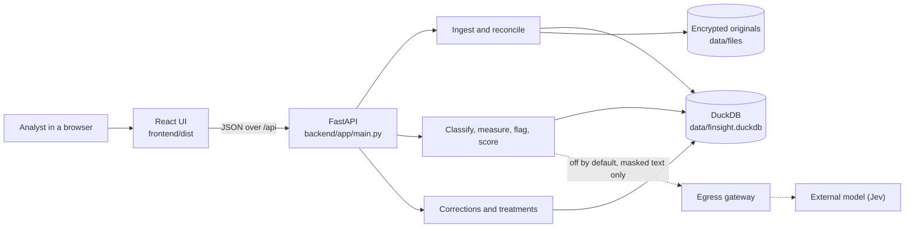
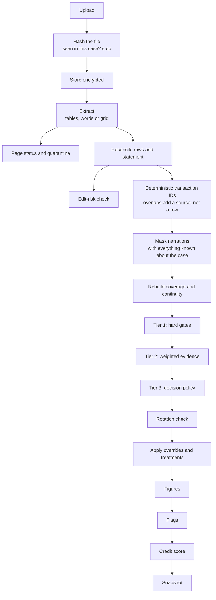
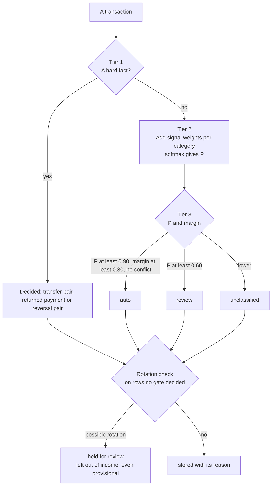
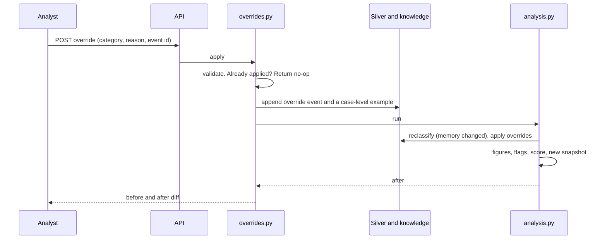
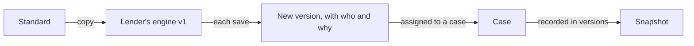

# Architecture

How FinSight is put together, how data moves through it, and where its limits are. For the reasoning behind each choice, see [DECISIONS.md](DECISIONS.md); references such as D-07 point there.

## 1. Purpose and constraints

FinSight supports a credit analyst reviewing bank statements. It informs a credit review. It does not approve or decline credit.

Five properties shape the design:

| Property | What it means in practice |
|---|---|
| **Deterministic** | The same files and versions give the same figures. No model decides a category, a figure or a score (D-01) |
| **Traceable** | Every figure lists the rows it included and excluded, with reasons. Every row keeps its file, page and row number |
| **Honest about gaps** | A missing month is unknown, never zero. An unreadable page is reported, never skipped. An uncertain row waits for a person (D-03) |
| **Correctable** | An analyst can change any label. The original stays, and every dependent figure is recalculated |
| **Private by default** | Identifiers are masked for display and replaced with placeholders for classification. Clear values live only in an encrypted vault |

## 2. System overview

One Python process serves the API and the built UI, and keeps everything in one DuckDB file plus a folder of encrypted originals.



| Layer | Technology |
|---|---|
| API | FastAPI, uvicorn |
| Reading files | pdfplumber, openpyxl, standard `csv` and `json` |
| Storage | DuckDB, one file with six schemas |
| Similarity and name matching | scikit-learn (TF-IDF), RapidFuzz |
| Encryption | `cryptography` (Fernet), HMAC-SHA256 |
| Report PDF | ReportLab |
| UI | React 18, TypeScript, Vite, Recharts |

All versions are pinned exactly in `backend/requirements.txt` and `frontend/package.json`, so an analysis can be reproduced.

## 3. Code map

```
backend/app/
  main.py          HTTP routes. Serves frontend/dist when it exists
  config.py        Paths, versions, thresholds
  db.py            Schema, connection, transaction helper
  money.py         Amount and date parsing, formatting
  analysis.py      Runs silver to gold; snapshots; diffs; engine comparison
  fx.py            Exchange rates and conversion
  rule_engine.py   Lender settings, versions, assignment
  report.py        The evidence-linked report as data
  report_pdf.py    The same report as a PDF
  evaluation.py    Accuracy against sample ground truth
  ingest/          extract.py (read files), layout.py (find columns and header fields),
                   normalize.py (channel, counterparty, references), service.py (upload pipeline)
  validate/        reconcile.py (balance arithmetic), tamper.py (edit risk)
  dedup/           coverage.py (months covered, gaps, overlaps, balance continuity)
  classify/        categories.py, rules.py, engine.py (the three tiers), periodic.py (monthly series),
                   semantic.py (similar examples), rotation.py, jev_client.py
  metrics/         effective.py (the category in effect), engine.py (figures), score.py, history.py
  flags/rules.py   Every risk indicator
  review/          overrides.py (corrections)
  security/        crypto.py, pii.py, rbac.py, audit.py, egress.py, log_scrub.py
frontend/src/      App.tsx, api.ts, types.ts, views/ (one file per screen), components/
backend/tests/     Tests and evaluation harnesses
scripts/verify.py  Runs every check and prints one table
datagen/           Generators for the sample cases and the multilingual dataset
datasets/          multilingual_v1 (generated, labelled)
sample_data/       Demo cases, the Riya Sharma package, problem files, edited PDFs
```

Dependencies point one way: routes call services, services call the classifier and metrics, and everything uses `db`, `config` and `security`.

## 4. The pipeline



### 4.1 Upload and extraction

`ingest/service.py` runs this on each upload, inside the request.

1. **Refuse the obvious.** Only `.pdf`, `.csv`, `.xlsx` and `.json`, up to 15 MB, and not empty.
2. **Hash.** The file's SHA-256 and the case give its ID. The same file in the same case is logged as a duplicate upload and not processed again. The exception is a locked PDF retried with a password.
3. **Store.** The original is written encrypted to `data/files/<sha256>.bin`.
4. **Extract.** All formats produce one shape: header fields, rows and a status for every page.

PDF reading tries increasingly weak sources of structure:

| Step | Used when | Method recorded |
|---|---|---|
| Header row names the columns | Normal tables, including wrapped headers such as `Withdra\nwal` | `pdfplumber.tables` |
| Columns carried from the previous page | A table continues with no header | `pdfplumber.tables` |
| Columns inferred from the data | The labels are missing from the text layer. The balance chain settles which column is debit and which is credit | `pdfplumber.tables+columns_from_data` |
| Word positions | No ruling lines | `pdfplumber.words` |

Rotated characters are dropped first, because diagonal watermarks otherwise leak letters into cells.

Each page ends with one status: `parsed`, `partial`, `no_transactions`, `needs_ocr` or `failed`. There is no OCR, so a scanned page is reported as `needs_ocr` and its content is not used (D-17).

Anything that cannot be read goes to `bronze.quarantine` with a reason: a row, a missing account number, a date years away from the rest of its statement, a balance break, or a row worded differently from its copy in another statement.

### 4.2 Accounts, currencies and statements

- An account is created only from a file that yields rows, so a scanned PDF does not produce a phantom account.
- A file with a currency column becomes one account per currency, each with its own balance chain.
- A currency that is stated is recorded as `stated`. Otherwise INR is `assumed`, and the record says so.
- An opening balance that is not printed is derived from the first row and marked `derived`.

### 4.3 Reconciliation

Reconciliation runs at three levels (`validate/reconcile.py`, `dedup/coverage.py`):

| Level | Check | Result |
|---|---|---|
| Row | Previous balance + credit − debit = printed balance | `ok`, `break` or `unverified`. If the next row continues from the computed value, the break is called a misprint. If not, it may be a missing or misread row |
| Statement | Opening + credits − debits = stated closing | `reconciled`, `reconciled_no_closing`, `reconciled_with_row_breaks`, `breaks`, `unreconciled` or `unverified` |
| Across statements | Consecutive statements of one account | `continuous`, `gap`, `overlap` or `balance_mismatch` |

These results are stored as facts. Whether a statement is acceptable is a separate judgement, made each time by `case_view` against the lender's rules (allowed difference, breaks allowed, whether a closing balance must be printed).

### 4.4 De-duplication

Three things are de-duplicated in three ways:

| Duplicate | How it is caught |
|---|---|
| The same file twice | File hash per case |
| Overlapping statements | The transaction ID comes from the row's content. A row seen again adds a `txn_sources` entry, not a transaction |
| The same statement as PDF and CSV | The ID uses date, amounts and balance. A narration is used only when there is no balance, and then with spacing and punctuation removed. Different wording is recorded as `narration_differs` and counted once |

An ordinal is added to the ID, so two genuinely identical rows in one statement stay separate.

### 4.5 Masking

`renormalize` masks every narration in the case again after each upload, because each new statement may reveal another own account or holder name. It writes two forms (see [SECURITY.md](SECURITY.md)):

- `description`, for display: identifiers masked to the last four, the holder shown as `[Holder]`.
- `description_norm`, for classification: placeholders such as `<HOLDER>`, `<OWN_ACCT>` and `<UPI>`.

### 4.6 Classification

Three tiers, then a rotation check. [CLASSIFICATION.md](CLASSIFICATION.md) has the full detail.



Each run is stored whole in `silver.classifications` with its signals, so history is kept. A run is skipped when its input hash is unchanged. That hash covers transaction IDs, masked narrations, versions, the memory version and exchange rates.

### 4.7 The category in effect

`metrics/effective.py` is the one place that decides what a row counts as:

1. Start from the latest classification run.
2. The latest analyst override wins, and the row becomes `confirmed`.
3. The latest treatment wins over both: `exclude` sets `ANALYST_EXCLUDED`, `include` forces it to count, and `clear` removes the decision.
4. Foreign amounts are converted to INR at a supplied rate. A row with no rate is marked `fx_missing`, and `analysis.py` keeps it out of every figure and reports it.

Everything downstream reads this view. Overrides never edit classification results.

### 4.8 Figures, flags and score

`analysis.py` calls these in order, each from the effective rows and the case's rule engine:

| Step | Module | Output |
|---|---|---|
| Figures | `metrics/engine.py` | Income, obligations, FOIR, affordability, surplus, net cash flow, balances, trend, money movement, account views |
| History | `metrics/history.py` | Account timelines, earnings, statements to ask for |
| Reconciliation view | `validate/reconcile.py` | Each statement against the lender's rules |
| Flags | `flags/rules.py` | Risk indicators, each with its rule and rows |
| Score | `metrics/score.py` | 0 to 100, or withheld with a reason |

See [CALCULATIONS.md](CALCULATIONS.md).

### 4.9 Snapshots

A snapshot's ID comes from a hash of everything it was computed from: rows, categories, statuses, treatments, rates, engine version, coverage, statement status, files, edit scores, versions and application date. This has three effects:

- Recomputing with identical inputs returns the existing snapshot, so a new one appears only when something really changed.
- Undoing a decision returns to the earlier state. That snapshot is found by hash and made current again (D-10).
- Two snapshots can be compared directly, which is how a correction shows what it changed.

`GET /analysis` returns the latest snapshot, and recomputes first if it was made by older rules, pipeline, weights or engine versions. So **a read can write**: the first request after a version change does the work (D-05).

## 5. The correction loop



A treatment follows the same pattern, without writing to memory. A note never changes a figure, so it does not trigger an analysis.

A correction is about one row. Its narration joins that case's similarity memory, but it can only influence rows that cannot decide on their own evidence (`settled` in `classify/engine.py`). This came from a real failure, where one correction took income to ₹0 by demoting neighbouring salary rows (D-61).

## 6. Rule engines

A rule engine is one lender's settings. `Standard` always exists as the reference and cannot be edited or deleted, and two samples show how a lender might differ.



- Only parameters the problem statement names can be set (`SETTINGS`). Anything else keeps a fixed default, and the API refuses it (D-54).
- A setting's source in the brief is shown beside it.
- Lender keyword rules join the fusion step like any other signal, with bounded weights.
- `compare_engines` measures the case under every engine without saving. It compares figures and scores, not labels, because an engine's labelling rules apply only once it is assigned.

## 7. The user interface

A single-page React app. `App.tsx` holds the case list, role picker and tabs. `api.ts` sends the demo role headers.

| Tab | View | Shows |
|---|---|---|
| Overview | `Overview.tsx`, `MetricDrawer.tsx` | Figures, trend, money moving around. Clicking a figure lists its rows included and excluded |
| Credit score | `CreditScore.tsx` | Each parameter's value and points, engine choice and comparison |
| Report | `Report.tsx` | The assessment, and its PDF |
| Earnings | `Earnings.tsx` | Receipts, costs and earnings by month, and who pays |
| Categories | `Categories.tsx` | Totals by category |
| Accounts | `Accounts.tsx` | Account history, coverage, exchange rates |
| Reconciliation | `Reconciliation.tsx` | Each statement's arithmetic against the lender's rules |
| Transactions | `Transactions.tsx`, `TxnDrawer.tsx` | Rows. Clicking one shows its reason, sources, links and history, and lets an analyst correct, exclude, annotate or reveal |
| Statements | `Statements.tsx` | Uploads, page status, quarantine, edit risk |
| Indicators | `Flags.tsx` | Risk indicators with rules and rows |
| Review queue | `Review.tsx` | Rows waiting for a decision |
| Accuracy | `Accuracy.tsx` | Results against ground truth on sample cases |
| Audit log | `Audit.tsx` | The audit log and its chain check |

The `RuleEngines.tsx` page sits outside the case tabs. Money arrives in paise and is formatted only for display (`fmt.ts`).

## 8. Runtime and concurrency

- **One process.** `db.py` shares one DuckDB connection behind a re-entrant lock. Stage outputs are replaced inside one transaction.
- **One analysis at a time.** A process-wide lock in `analysis.py` serialises every computation, across all cases. When two requests want the same result, the second finds the first's.
- **Work happens in the request.** There is no background queue. Upload and analysis finish before the response returns.
- **Starting up** connects, applies the schema, adds any new columns in place, and seeds the similarity examples and built-in engines. All of these are idempotent.

Measured on the multilingual set: about 0.65 s per statement end to end, about 0.66 s for a correction with full recalculation on a 323-row case. This suits one team on one machine and would not scale out as it stands (D-06).

## 9. How failures are handled

| Failure | Behaviour |
|---|---|
| Corrupt or unsupported file | The file is `failed` with a reason, and the case carries on |
| A reader crashes on a file | Caught, logged and reported as unreadable. The upload still returns |
| Locked PDF | `needs_password`. Retrying with the password works. The password is not stored |
| Scanned page | `needs_ocr`, and a high-severity flag |
| Unreadable row | Quarantined with its reason |
| Year far from the rest of the statement | Row quarantined, so it cannot stretch the statement across decades |
| No exchange rate | Row left out of every figure, and a `fx_rate_missing` flag |
| Too little to score | Score withheld with a reason |
| Unexpected server error | A plain message to the screen. Detail goes to the log, scrubbed of personal data |
| Retried request | `Idempotency-Key` or `event_id` returns the first result |
| Crash during a stage | The transaction rolls back and the stage's earlier output stays |

`backend/tests/test_robustness.py` exercises hostile files, wrong API calls and simultaneous uploads.

## 10. Known gaps

Found while writing this documentation by reading the code. None of these has been changed.

### Documents and code that disagree

| Item | Detail |
|---|---|
| Stale note shown to users | `metrics/engine.py:418` says affordability limits "are fixed defaults, not a lender's policy". They are not: `max_foir` and `min_surplus_after_obligations_paise` come from the rule engine and lenders can edit them. The note is attached to the affordability figure |
| `silver.case_rules` | The table exists and nothing reads or writes it. Limits come from the rule engine |
| "Floats never touch amounts" | True for stored amounts, row arithmetic and sums, and exchange conversion uses `Decimal`. Not strictly true for aggregates: medians and means go through Python's `statistics` and are truncated to whole paise. This cannot change a result by more than a paisa at realistic sizes. See D-02 |
| "Bronze is append-only" | The `db.py` docstring says so, but reprocessing a file, such as a locked PDF retried with its password, replaces that file's bronze rows |

### Designed but not fully built

| Item | Detail |
|---|---|
| Promoting examples to global memory | The `promote_global` permission exists and no route uses it. Global memory holds only the seeded examples. Analyst corrections stay at case level |
| New categories through approval | There is no such workflow. Categories change in code, with a rules version bump |
| `review.stage_runs` | Written on ingest, never read |
| OCR | Not built |
| Real sign-in | Roles come from request headers, which anyone can set. See [SECURITY.md](SECURITY.md) |
| Deleting a case or file | There is no route for it, and so no way yet to honour a retention limit or an erasure request |

### Limits of the current design

| Item | Detail |
|---|---|
| Upload blocks the server | `upload_file` is an `async def` that reads and processes the file inline, so other requests wait while a large file is processed |
| Global analysis lock | One slow analysis delays every other case |
| Enabling Jev weakens reproducibility | Jev signals enter the Tier 2 sum. The version record says only `enabled`, not which model. Answers are cached in memory only, and a failed call silently contributes nothing, so the same inputs could give different results. It is off by default and has never run against a real API |
| Audit write is separate | An override commits first and its audit entry follows, so a crash between them leaves an unlogged override |
| Audit chain has no outside anchor | It reveals an edit to one entry. Someone able to rewrite the whole table could rebuild the chain |
| Other people's names are not masked | Only the holder's name is masked. A counterparty's name stays in clear in `description` and `description_norm`, in any script. For example, `IMPS/MOHAN VERMA` from the sample data displays as printed. The egress re-scan looks for identifiers, not names, so it would not catch these. This must be fixed before any external model is enabled |

Other known weaknesses, including Tamil coverage and business income in regional languages, are in `EVALUATION.md` and the backlog in [`HANDOFF.md`](../HANDOFF.md).
