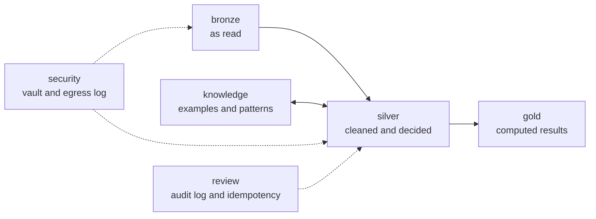

# Data model

Everything is in one DuckDB file, `data/finsight.duckdb`, defined in `backend/app/db.py`. Encrypted originals are in `data/files/<sha256>.bin`.

**Do not delete `data/`.** It holds every uploaded case, and there is no backup. Point `FINSIGHT_DATA_DIR` elsewhere to work on a separate copy.

## Conventions

| Convention | Detail |
|---|---|
| Money | `BIGINT` in hundredths of the account's currency, as printed. Rupee values are worked out when read, not stored |
| Exchange rates | `VARCHAR`, so that no float touches them. Parsed as `Decimal` |
| Times | UTC with no time zone |
| JSON | `VARCHAR` columns written with sorted keys, so that hashes are stable |
| History | Decisions are appended as events, and the latest wins |
| Foreign keys | None are declared. Joins follow the ID columns below |

## Schemas



## Bronze: as read

| Table | One row per | Key columns |
|---|---|---|
| `files` | File in a case. Unique on `(case_id, sha256)` | `file_id`, `sha256`, `filename`, `kind`, `status`, `reason` |
| `upload_events` | Upload attempt, including duplicates | `event_id`, `file_id`, `duplicate`, `actor` |
| `pages` | Page | `file_id`, `page_no`, `status`, `reason`, `n_rows`, `method` |
| `raw_rows` | Row, with cells encrypted | `file_id`, `page_no`, `row_no`, `cells_enc` |
| `quarantine` | Item that could not be used | `q_id`, `page_no`, `row_no`, `kind`, `reason`, `detail` |

- `files.status`: `processing`, `processed`, `partial`, `failed`, `needs_password`.
- `pages.status`: `parsed`, `partial`, `no_transactions`, `needs_ocr`, `failed`.
- `quarantine.kind`: includes `unreadable_row`, `missing_account_number`, `balance_break`, `narration_differs`, `file_failed` and `file_needs_password`.

A file's page, row and quarantine entries are replaced if it is processed again.

## Silver: cleaned and decided

### Statements and rows

| Table | One row per | Key columns |
|---|---|---|
| `cases` | Applicant review | `case_id`, `name`, `application_date`, `profile`, `is_demo` |
| `accounts` | Account and currency | `account_id`, `acct_token`, `acct_masked`, `bank_name`, `holder_token`, `holder_masked`, `currency`, `currency_source` |
| `statements` | Statement, per currency | `statement_id`, `file_id`, `account_id`, `period_start`, `period_end`, `opening_paise`, `opening_source`, `closing_stated`, `computed_closing`, `recon_status`, `recon_diff`, `n_breaks` |
| `transactions` | Unique transaction | `txn_id`, `account_id`, `txn_date`, `description`, `description_norm`, `desc_token`, `debit`, `credit`, `balance`, `channel`, `counterparty`, `ref_tokens`, `recon_status`, `recon_note`, `seq` |
| `txn_sources` | Place a transaction was seen | `txn_id`, `statement_id`, `file_id`, `page_no`, `row_no` |
| `coverage` | Account and month | `month`, `status` (`full`, `partial`, `missing`), `days_covered` |
| `cross_checks` | Consecutive statement pair | `kind` (`continuous`, `gap`, `overlap`, `balance_mismatch`), `expected`, `actual`, `detail` |
| `document_checks` | File's edit-risk result | `score`, `structure_score`, `level`, `signals` |

`txn_sources` is what makes overlaps visible: one transaction, several sources.

### Classification and decisions

| Table | One row per | Key columns |
|---|---|---|
| `classification_runs` | Run. History is kept | `run_id`, `input_hash`, `versions`, `seq` |
| `classifications` | Row in a run | `run_id`, `txn_id`, `category`, `status`, `tier`, `source`, `probability`, `margin`, `explanation`, `contributions`, `candidates`, `attributes` |
| `txn_links` | Pair from the latest run | `txn_a`, `txn_b`, `kind`, `reason` |
| `overrides` | Analyst correction | `event_id`, `txn_id`, `from_category`, `to_category`, `reason`, `actor`, `role` |
| `txn_treatments` | Exclude, include or clear | `event_id`, `txn_id`, `action`, `reason`, `actor`, `role` |
| `analyst_notes` | Note on a case or row | `note_id`, `txn_id`, `text`, `actor` |
| `fx_rates` | Rate. An empty `month` applies to every month | `currency`, `month`, `rate`, `source`, `actor` |

- `status`: `auto`, `review`, `unclassified`. An override or treatment gives `confirmed` when read.
- `tier`: `gate`, `fusion`, `rotation`.
- `txn_links.kind`: `transfer_pair`, `bounce_pair`, `reversal_pair`, `rotation_near`, `rotation_split`, `rotation_party`, `rotation_pass`.

### Rule engines

| Table | One row per | Key columns |
|---|---|---|
| `rule_engines` | Engine, at its current version | `engine_id`, `name`, `version`, `config`, `is_sample`, `updated_by` |
| `rule_engine_history` | Saved version | `engine_id`, `version`, `config`, `actor`, `note` |
| `case_engine` | Case with an assigned engine. With none, Standard applies | `case_id`, `engine_id`, `actor` |
| `case_rules` | Unused. Nothing reads or writes this table | |

## Gold: computed results

| Table | One row per | Key columns |
|---|---|---|
| `snapshots` | Distinct result. Unique on `(case_id, input_hash)` | `snapshot_id`, `input_hash`, `trigger`, `seq`, `payload` |

The highest `seq` is current. `payload` is JSON:

| Key | Holds |
|---|---|
| `versions` | Pipeline, rules, weights, engine, question bank, memory, Jev state |
| `metrics` | Each figure with `value`, `method`, `included`, `excluded`, `months_used`, `months_missing` and `notes` |
| `monthly` | One row per month: coverage, credits, debits, adjusted amounts, income, obligations, net and balances |
| `flags` | Each indicator with code, severity, title, detail, rule, rows and months |
| `credit_score` | Score, band, reason and each parameter's value, points and rows |
| `reconciliation` | Each statement against the engine's rules |
| `money_flows`, `account_view`, `earnings`, `statement_requests` | The screens of those names |
| `accounts`, `statements`, `cross_checks`, `patterns`, `edit_checks` | Context at the time |
| `categories` | `{txn_id: [category, status]}`, used for comparing snapshots |
| `fx` | Rates in force, and what has none |

## Knowledge

| Table | One row per | Key columns |
|---|---|---|
| `semantic_examples` | Approved narration | `example_id`, `scope` (`global`, `case`), `case_id`, `text_norm`, `category`, `source`, `approved_by` |
| `periodic_patterns` | Monthly series from the latest run | `pattern_id`, `account_id`, `direction`, `counterparties`, `median_amount`, `amount_cv`, `typical_day`, `months`, `missed_months`, `expected_next`, `txn_ids` |

## Review

| Table | One row per | Key columns |
|---|---|---|
| `audit_log` | Action | `seq`, `ts`, `actor`, `role`, `action`, `case_id`, `target`, `details`, `prev_hash`, `hash` |
| `idempotency_keys` | Keyed request | `key`, `request_hash`, `status_code`, `response` |
| `stage_runs` | Ingest of a file. Written, never read | `file_hash`, `case_id`, `stage`, `pipeline_version` |

## Security

| Table | One row per | Key columns |
|---|---|---|
| `pii_vault` | Clear value, encrypted | `token`, `kind` (`acct`, `name`, `desc`), `value_enc` |
| `egress_log` | Attempt to call an external model | `target`, `payload_masked`, `blocked`, `reason` |

## How IDs are made

| ID | Made from | Effect |
|---|---|---|
| `file_id` | Case + file hash | The same file in a case is one file |
| `account_id` | Case + account token | Statements of one account join up |
| `statement_id` | File + account token + period | |
| `txn_id` | Account, date, debit, credit, balance (or the narration with spacing and punctuation removed), ordinal | The same row from any statement or format is one transaction |
| `q_id` | File + page + row + kind | Reprocessing does not repeat quarantine entries |
| `run_id` | `run_<end of case id>_<seq>` | |
| `snapshot_id` | `snap_` + first 12 of the input hash | Identical inputs give the same snapshot |
| `case_id` | Random. Demo cases use a stable hash of their key | |

Account tokens use the HMAC key, so IDs differ between installations. Changing the ID recipe or tokenisation needs a reset.

## Two hashes decide when work is repeated

| Hash | Covers | When it matches |
|---|---|---|
| Classification `input_hash` | Transaction IDs, masked narrations, versions, memory version, exchange rates | The previous run is reused |
| Snapshot `input_hash` | Case, every row's category, status and treatment, rates, engine version, coverage, statement status, files, edit scores, versions, application date | The stored snapshot is returned and made current |

## Tracing a figure to its source

1. In the snapshot, read `metrics.<key>.included`, or `excluded` with its reasons.
2. For each `txn_id`, read `silver.txn_sources` for the file, page and row.
3. Read `silver.classifications` for the signals, and `silver.overrides` and `silver.txn_treatments` for decisions.
4. `bronze.raw_rows` has the row as read, encrypted.

Example, for why rows left income out:

```sql
SELECT t.txn_date, t.description, c.category, c.status, c.explanation, f.filename, s.page_no, s.row_no
FROM silver.transactions t
JOIN silver.txn_sources s USING (txn_id)
JOIN bronze.files f USING (file_id)
JOIN silver.classifications c USING (txn_id)
WHERE t.case_id = ?
  AND c.run_id = (SELECT run_id FROM silver.classification_runs WHERE case_id = ? ORDER BY seq DESC LIMIT 1)
  AND c.status <> 'auto' AND t.credit > 0
ORDER BY t.credit DESC;
```

This shows the classifier's result, before any override. Stop the server first or work on a copy of the file: DuckDB allows one writer process.
